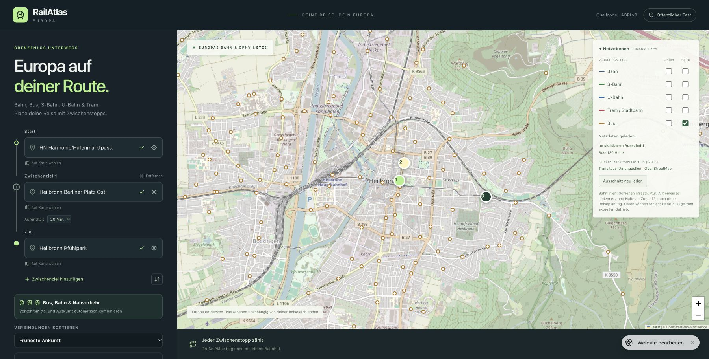

# Version 24: AGPLv3 und Kartenhalte – Veröffentlichung geprüft

26.10.2026, Europe/Berlin. Source `202529ae7200ecd354bcbb7597e3f70c80932b48`.
Nativ veröffentlicht: https://railatlas-europa.cocoaamber33.chatgpt.site
GitHub-Codecommit: `e75c063be47dc741962de3610d7c9db58f77e404`.
198 App-Dateien bytegleich, AGPL-3.0-only für eigenen Programmcode.
97 Regressionen, TypeScript und drei Builds erfolgreich; GitHub CI und
Check RailAtlas shared application für diesen Codecommit erfolgreich.

## Öffentliche API

Nur `/api/network`, keine Fahrtsuche und keine experimentellen Transitous-Linien.

| Prüfgebiet | Detail | HTTP | Ergebnis |
| --- | --- | --- | --- |
| Heilbronn | Bus-Halte | 200 | 7 Halte |
| London | Bus-Halte | 200 | 12 Halte |
| Amsterdam | Bus-Halte | 200 | 6 Halte |
| Prag | Bus-Halte | 200 | 8 Halte |
| Welsede | Bus-Linien und Halte | 200 | Linien 40/45, Mitte und Hanebülten |
| Lizenztext | `/LICENSE.txt` | 200 | bytegleich mit LICENSE |

Die ersten vier Grenzen stehen im [Quellenprotokoll](../transit-network-coverage.md).
Prag hatte vor Feed-Zusammenführung zehn Einträge. Welsedes vier DELFI-/VBN-IDs
bleiben an den zwei zusammengeführten Halten erhalten. Der Lizenztext hat SHA-256
`d8a6cc31abc16b6748c7a21f21611f5a1ec33f67d22ca23d7da1c19b95496bee`.
Transitous- und OSM-Attributionslinks sind in den API-Antworten enthalten.

## Tatsächliche Browserprüfung

Veröffentlichte Oberfläche im verbundenen Chrome geöffnet, bestehende Schalter
verwendet, nur Bus-Halte aktiviert. Ohne Verbindungssuche sind allgemeine Marker,
Zähler und die Transitous-/OSM-Quellenlinks sichtbar. AGPL-Quellcode-Link im Kopf
bestätigt. Echte Busmarker angeklickt und die folgenden Popupaktionen ausgeführt:

- Als Start: HN Harmonie/Hafenmarktpass.
- Als Zwischenziel: Heilbronn Berliner Platz Ost, Aufenthalt 20 Minuten erhalten.
- Als Ziel: Heilbronn Pfühlpark; vorhandener Start und Zwischenziel bleiben erhalten.

Jede Übernahme wurde am jeweiligen Formularfeld bestätigt. Das Bildschirmfoto
zeigt alle drei ausgewählten Halte und die unabhängigen Kartenmarker. Der im
Bild sichtbare Zähler 130 gilt für diesen größeren sichtbaren Heilbronner
Ausschnitt, die API-Probe mit sieben Halten für den kleineren dokumentierten.

Es wurde keine neue Live-Fahrplanbestätigung für diese drei Kartenhalte behauptet
und kein GPS verwendet. Die interne Vorschau war wegen DNS nicht erreichbar;
die UI-Prüfung erfolgte nach regulärer Veröffentlichung auf dem bestehenden Host.
Europaweite Vollständigkeit, Echtzeitabdeckung und zusätzliche Liniengeometrien
bleiben offen. GitHub Pages bleibt Version 12 bis zum eigenen HTTPS-API-Server.
