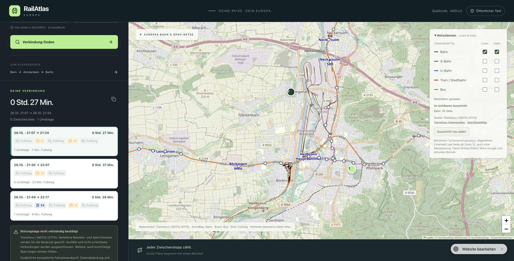

# Verbindungssuche repariert – Version 26

26.10.2026, Europe/Berlin. Native Source
`72f0ef86e9e6c89b9b90deb510ec6c0b26ecf917`, GitHub-Codecommit
`0d2200f73d6c1334c2631265282782371ad3d96c`.
199 App-Dateien bytegleich; AGPL-3.0-only und bestehende öffentliche Testfreigabe.
103 Regressionen, TypeScript und alle drei Builds erfolgreich. Beide GitHub-
Prüfläufe für den Codecommit erfolgreich.

## Ursache und Korrektur

Kartenhalte aus Transitous waren vorhanden, die Fahrtsuche nutzte jedoch nur die
bisherigen Auskünfte. ÖBB/EFA fanden Friedhof und Römerstraße nicht zuverlässig
per Namen. EFA erkannte in einer separaten Diagnose die bestätigten DHIDs,
lieferte aber keine Reise (BROKER -10015/-4000). Transitous liefert echte Reisen.
Die gemeinsame automatische API verwendet diesen stabilen Fahrplan nun nach
Erfolgslosigkeit der bisherigen Quellen und vor DB. Ein begrenzter Abruf, kurzer
Cache, keine Schleife und keine automatische Folgetagssuche.

## Ausgeführte Prüfungen

| Prüfung | Ergebnis |
| --- | --- |
| Eigenständiger Node-HTTP-Server, native GTFS-Kartenhalte, ab 20:51 | HTTP 200, drei Reisen; darunter Bus 11 / vier Minuten Quellfußweg / Bus 32, 21:09–21:33 |
| Öffentliche Version-25-API, gleiche native Halte | HTTP 200, dieselben drei Optionen |
| Öffentliche Version-25-API, Rückrichtung ab 20:55 | HTTP 200, drei Optionen; erste Bus 31 / Fußweg / 11, 21:24–21:50 |
| Veröffentlichte Version 26, Formular mit getippten OSM-Halten ab 21:05 | Drei Alternativen; erste 21:07–21:34 mit Bus 11 und 32, sieben Minuten Fußweg insgesamt |
| Version 26, Koordinatenlabels | Gewählte Namen Friedhof und Römerstraße im Reiseverlauf statt START/END |
| Fahrzeuggeometrie | Als unbestätigt benannt und nicht als Originalpfad gezeichnet |
| Quellfußwege und Attribution | Geroutete Originalpunkte; Transitous-/OSM-Links sichtbar im Reiseergebnis |

Die OSM-Punkte liegen neben den nativen Bushalten und erhalten eigene bestätigte
Zugangs-/Abgangswege. Deshalb dauert die Browserreise eine Minute länger als die
Suche mit nativen IDs. Fahrzeugzeiten bleiben unverändert. Endpunkte müssen
innerhalb von 30 m liegen; entfernte oder anders benannte Ersatzhalte werden
nicht akzeptiert. Zwischenziele verwenden denselben API-Pfad.

Die Regressionen prüfen zusätzlich Ausfälle, aktive und abgelaufene Meldungen,
Zeitkonflikte, falsche Endpunkte, unbekannte Modi, unbestätigte Kalenderverlängerung,
fehlende Gehwege, Cachevalidierung, Retry-After, Abbruch und das Ausbleiben einer
zusätzlichen Anfrage bei erfolgreicher EFA. Keine Testfixture dient als Laufzeitdaten.
Europaweite Vollständigkeit und lückenlose Echtzeit-/Sperrungsabdeckung bleiben
unbestätigt. Allgemeine Liniengeometrie ist eine separate offene Aufgabe.
GitHub Pages bleibt Version 12 bis zum eigenen HTTPS-Auskunftsserver.
