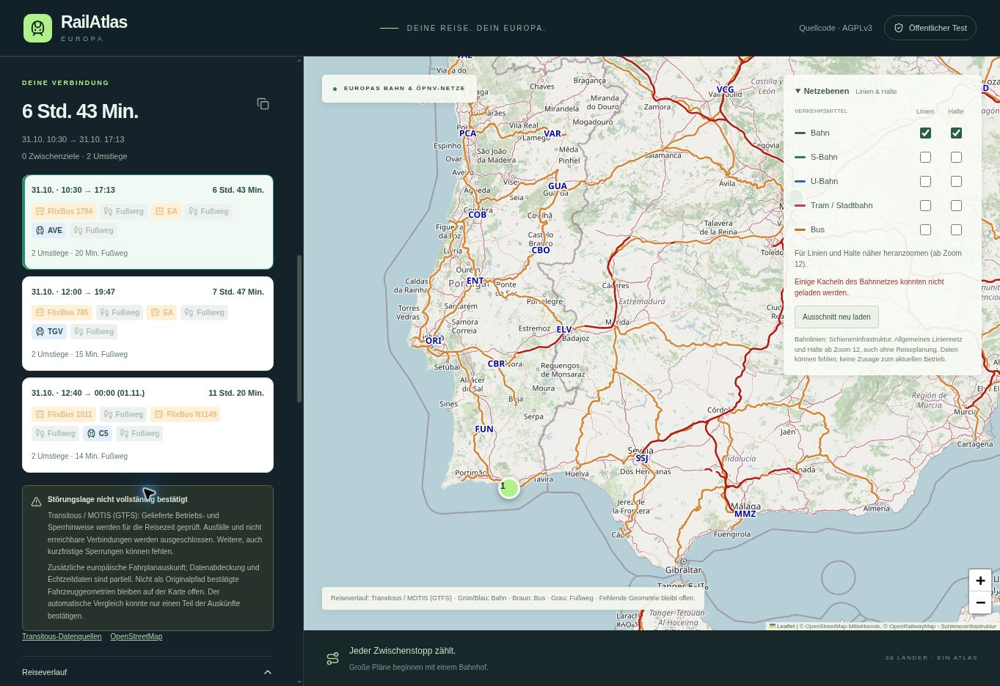
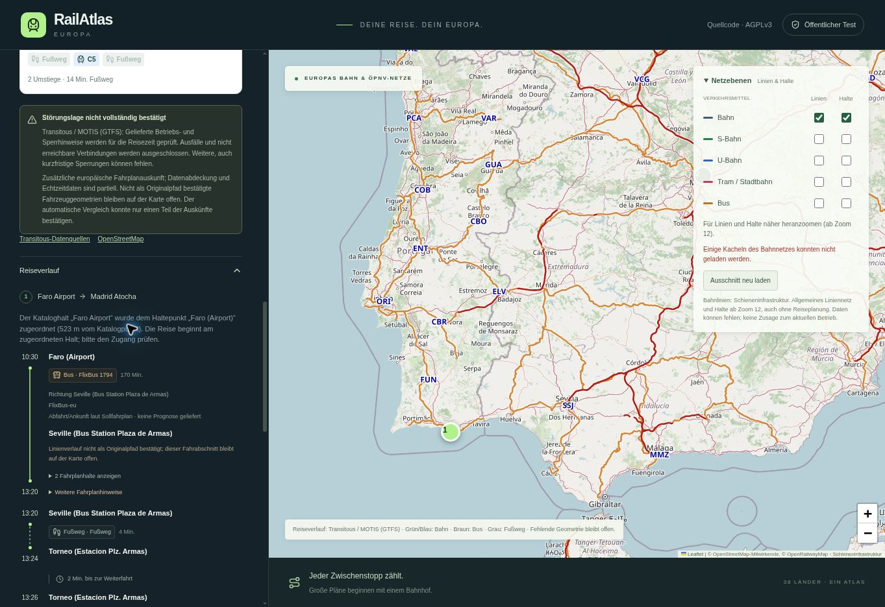
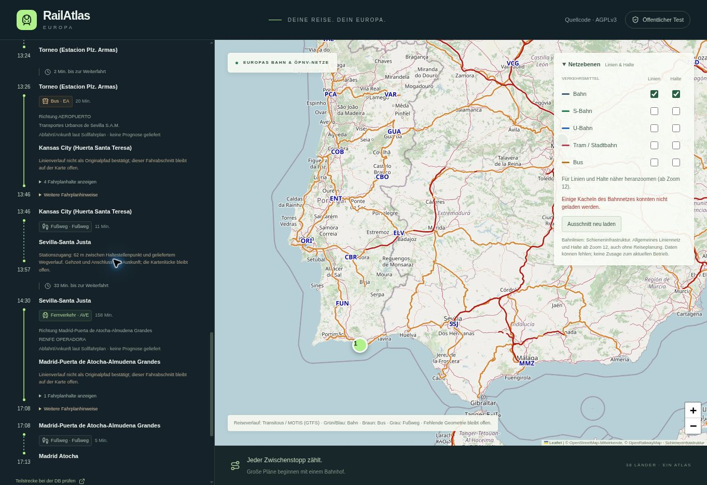

# RailAtlas Version 27 – veröffentlichte Faro-Suche

Am 27.10.2026 geprüft. Öffentliche Site:
https://railatlas-europa.cocoaamber33.chatgpt.site/

Sites-Version **27**, Quellcommit
`2ac3e41f0a72fdc25e28b8d1ea56f672a47e7952`.
GitHub-Implementierungscommit
`cf0eb05b56fd6fc26ed9a422ce318f42d856e165`.
Das Manifest bestätigt alle **200 App-Dateien** bytegleich einschließlich der
neuen echten Faro-/Madrid-Regression. Beide GitHub-Workflows (`CI` und
`Check RailAtlas shared application`) sind für diesen Implementierungscommit
erfolgreich. Die folgenden Bildschirmfotos und Dokumentationsänderungen ändern
den App-Quellstand nicht.

## Ergebnis und tatsächlicher Fehler

Der alte Katalogpunkt Faro Airport lag 245 m vom Beginn des gelieferten
Koordinaten-Fußwegs entfernt. Außerdem verwarf die frühere 30-m-Regel die
Stationszugänge in Sevilla (62 bzw. 44 m zum Bahnsteigpunkt). Die Quelle lieferte
HTTP 200; eine andere erfolglose Auskunft führte zur irreführenden Sammelmeldung.

Die Suche ordnet den Kataloghalt ohne Anbieter-ID nun dem gleichnamigen nativen
Halt Faro (Airport) zu. Der 523-m-Abstand wird ausdrücklich angezeigt; die Reise
beginnt an diesem Halt. Für individuelle Koordinaten/GPS wird keine solche
Verschiebung vorgenommen. Native Bahn-Stationszugänge bleiben mit Originalzeit
und Originalpunkten als partieller Verlauf erhalten, höchstens 250 m und nicht
weiter als die gelieferte Quellgehstrecke. Lücken werden nicht verbunden. Die
30-m-Kontrolle bleibt für Koordinaten und gewöhnliche Bus-/Tramhalte bestehen.

## Öffentliche API

POST `/api/journeys`, ursprüngliche Katalogobjekte, automatische Auskunft,
Abfahrt `2026-10-31T08:00:00Z` = **09:00 Europe/Berlin**, **08:00 Faro**.
HTTP **200**, drei Reisen:

| Abfahrt–Ankunft in Europe/Berlin | Auskunft | Stationszugang |
| --- | --- | --- |
| 31.10. 10:30–17:13 | FlixBus 1794, Bus EA, AVE über Sevilla | 62 m, partieller Quellverlauf |
| 31.10. 12:00–19:47 | FlixBus 785, Bus EA, TGV über Sevilla | 44 m, partieller Quellverlauf |
| 31.10. 12:40–01.11. 00:00 | FlixBus 1011, FlixBus N1149, C5 über Lissabon | kein solcher Stationsversatz |

Alle drei Reisen enthalten echte gelieferte Fußwege und den Hinweis zur
Katalogzuordnung. Unbestätigte Fahrzeuggeometrien bleiben auf der Karte offen.
Keine Vollständigkeitszusage für kurzfristige Störungen oder Echtzeitdaten.

Zusätzlich Heilbronn Friedhof → Neckargartach Römerstraße mit nativen Karten-IDs,
31.10.2026 ab 09:00 Europe/Berlin: HTTP **200**, drei Reisen. Darunter Bus 11
09:09 → Umstieg mit Quellfußweg → Bus 32, Ankunft 09:32. Kein Zurückfallen auf
erfundene Katalog- oder Fremdanbieter-IDs.

## Browserprüfung

Die veröffentlichte Seite neu geladen, Faro Airport und Madrid Atocha aus den
echten Katalogvorschlägen gewählt, 31.10.2026 und 09:00 eingestellt und gesucht.
Sichtbar: drei Alternativen, erste Reise 6 Std. 43 Min. / 10:30–17:13,
523-m-Zuordnung, 62-m-Stationszugang und die Quellen-/Abdeckungshinweise.

## Gemeinsame Validierung

109 Node-Regressionen bestanden, TypeScript erfolgreich, drei Builds erfolgreich:
Sites, eigenständige Ausgabe und Pages-Ausgabe. Echter eigenständiger
Node-HTTP-Server bestätigt dieselben drei Faro-Reisen. Negative Prüfungen
verwerfen weiterhin den ursprünglichen 245-m-Koordinatenweg, falsche Halt-IDs,
überlange/geometrisch fehlende Wege, Zeitkonflikte und Ausfälle. Optionaler
Geocoder-Ausfall erhält sichere bisherige Abfragen; HTTP 429 pausiert weitere
Anbieterabfragen gemäß Retry-After. Abbruch und Cache geprüft.

Der öffentliche Test ist bestätigt. Die bisherige Pages-Veröffentlichung bleibt
Version 12, bis ein eigener freigegebener öffentlicher HTTPS-Server bereitsteht.
