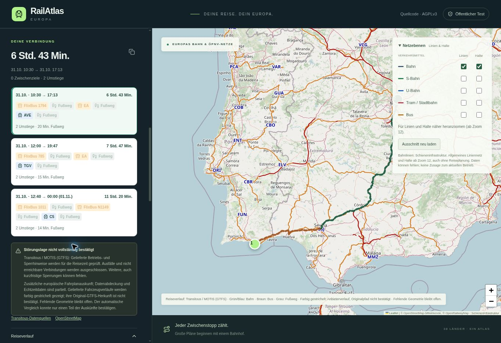

# RailAtlas Version 28 – Linienergänzung und gelieferte Reiseverläufe

28.10.2026. Sites-Quelle `4cf457308db624fc5e141151d7a09a5da41a2caf`.
Alle 200 App-Dateien entsprechen dem GitHub-Herkunftsmanifest.

## Konkrete Korrekturen

- Die gemeinsame API fragt fehlende Linien auch dann ergänzend bei OSM ab,
  wenn Transitous bereits Halte geliefert hat. Bestehende Linien, Halte und
  Originalkennungen bleiben erhalten; der ergänzende Abruf ist auf zwölf
  Sekunden begrenzt. Reine Halteabfragen benötigen ihn nicht.
- Gelieferte Transitous-Fahrzeugpolylinien werden unverändert übernommen.
  Herkunft nicht als Original-GTFS bestätigt: sichtbarer Text und farbig
  gestrichelte Darstellung. Keine erfundenen Endpunktverbindungen.
- Bei teilweisen Netzdaten zeigt die Oberfläche einen entsprechenden Status.
  Eine erfolgreiche Halteabfrage behauptet keine vollständige Linienkarte.

## Ausgeführte Prüfung

111 Node-Regressionen erfolgreich, TypeScript erfolgreich, Worker-, Pages- und
eigenständiger Build erfolgreich. Positive Regressionen prüfen ergänzte Linien
bei vorhandenen Halten sowie den Erhalt vorhandener Linien. Negative Regressionen
prüfen Quellenausfall, Abbruch, Rate-Limits, unbrauchbare Geometrie und erhaltene
Halte. Bestehende Gehweg-, Zeit-, Meldungs- und Endpunktprüfungen bleiben erfolgreich.

Die reale gespeicherte Faro–Madrid-Auskunft liefert neun Fahrzeugabschnitte mit
Geometrie. Vorher wurden alle neun verworfen. Jetzt bleiben die Quellpunkte
punktgenau erhalten. Auch die gespeicherten Bus-11/32-Reisen in Heilbronn behalten
Fahrzeiten, Halte, Gehwege und Echtzeitangaben und liefern Fahrzeugverläufe.

## Noch offene Grenze

Für die gemeldete allgemeine Tavira-Linienkarte war die bestehende Overpass-Quelle
in einer aktuellen begrenzten Probe nicht rechtzeitig erreichbar. Die geprüfte
offizielle alternative Instanz lieferte eine Gateway-Fehlerantwort. Das ist kein
Beleg für fehlende Buslinien. Ein vollständig sichtbares Tavira-Busnetz ist damit
noch nicht nachgewiesen. Die App muss vorhandene Halte erhalten und die fehlenden
Linien ausdrücklich benennen. Keine Garantie vollständiger europäischer Netz-
oder Fahrplanabdeckung.

Version 28 ist auf https://railatlas-europa.dunkelst.chatgpt.site veröffentlicht.
Die öffentliche API liefert HTTP 200 mit Browserfreigabe für GitHub Pages:
drei Faro–Madrid-Reisen für 31.10.2026 ab 09:00 Europe/Berlin, neun Fahrzeug-
verläufe mit 19.811 Quellpunkten. Die neue Herkunftskennzeichnung steht im
API-Ergebnis. Die Browserabnahme auf beiden Veröffentlichungen ist unten dokumentiert.

## Browserabnahme auf Sites und GitHub Pages

Am 28.10.2026 auf beiden tatsächlich veröffentlichten Seiten geprüft:
https://railatlas-europa.dunkelst.chatgpt.site/ und
https://dunkelst.github.io/railatlas-europe/.

Faro Airport und Madrid Atocha aus den Katalogvorschlägen ausgewählt,
31.10.2026 und 09:00 Europe/Berlin eingestellt und die automatische Suche
abgeschickt. Beide Seiten zeigen dieselben drei Alternativen: 10:30–17:13,
12:00–19:47 und 12:40–00:00 am 01.11.2026 (alle Zeiten Europe/Berlin).
Sichtbare Bus-/Bahnverläufe und der Hinweis auf ihre unbestätigte Original-GTFS-
Herkunft sind vorhanden. Der 523-m-Hinweis zur Haltestellenzuordnung und der
62-m-Stationszugang bleiben im Reiseverlauf erhalten.

Der Implementierungscommit `8384a3a477f125f536ffb0ef7ac5ef232a041e01`
ist in CI, gemeinsamer App-Prüfung und Pages-Veröffentlichung erfolgreich.
Der erneute Blob-Abgleich bestätigt alle 200 App-Dateien bytegleich mit der
Sites-Quelle. Dieser Nachtrag enthält nur Dokumentation und Bildschirmfotos;
App-Quellstand, native Veröffentlichung und Pages-Artefakt bleiben gleich.

