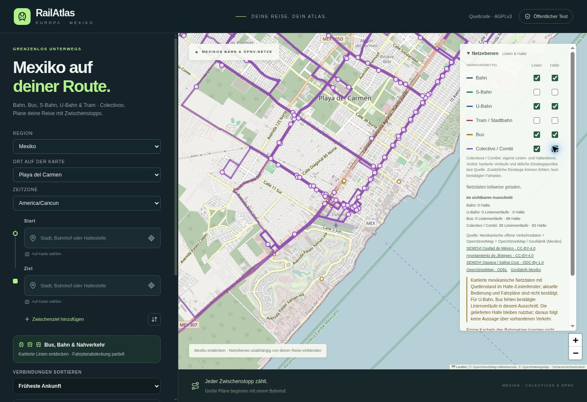

# RailAtlas 32 – Mexiko und Colectivos

Sites-Version 32, Quellcommit `47161c303822c85c7405db2f617bf39e935a2d86`,
öffentlich veröffentlicht am 28.10.2026. Alle 1.016 App-Dateien werden bytegleich
nach GitHub gespiegelt; `tsconfig.tsbuildinfo` ist ausgenommen.

## Ergebnis

Mexiko besitzt eine eigene Region mit 43 auswählbaren Orten, darunter die
Hauptstädte aller 32 Bundesstaaten. Colectivo-/Combi-Linien und kartierte Einstiege
sind unabhängig schaltbar. Landesweiter OSM-Auszug vom 27.10.2026: 140 Routen
mit Geometrie und 1.753 zugeordnete Haltepunkte. Regionale GTFS-Geometrien
werden ergänzt; 497 ausdrücklich virtuelle Salina-Cruz-Halte ausgeschlossen.
Keine künstlichen Halte oder interpolierten Linien, kein Ersatzfahrplan.

[Ortsproben, Datenalter, Quellen und Grenzen](mexico-consistency-2026-10-28.md).

## Prüfung

- 132 Regressionen erfolgreich, einschließlich der bisherigen europäischen
  Verarbeitung und echter mexikanischer OSM-/Transitous-Antworten.
- TypeScript, Worker-, Standalone- und Pages-Build erfolgreich.
- Öffentliche Version-31-Netzproben: Playa 38 Colectivo-Verläufe / 38 Halte;
  Uruapan 35 / 0; Mexicali leere Teilantwort. CDMX 24 U-Bahn-Verläufe / 34 Halte
  und 163 Busverläufe / 312 Halte, ohne Strukturfehler.
- Öffentliche Version-32-Reise-API: CDMX Buenavista → Puebla Explanada,
  31.10.2026 ab 09:00 America/Mexico_City, HTTP 200 und drei Alternativen.
  Erste Reise 09:00–11:15. Quellenanzeige jetzt ohne falschen Europa-Bezug.
- Browser: Die gleiche Reise wurde im öffentlichen Formular in Stand 31 gesucht
  und zeigt drei FlixBus-MX500-Alternativen. Start und Ziel aus der tatsächlichen
  Anbietersuche übernommen (Quellname „Mexico City“), kein fixer Beispielweg.
- Browser Stand 32: Europa → Bern–Amsterdam–Berlin-Beispiel → Mexiko/Playa
  wiederholt; die Karte landet nach dem Fix wieder in Playa. Die vorherige
  Zoomanimation konnte die alte Europakarte halten. Euro-Stationsfelder und
  Europe/Berlin bleiben verfügbar; Mexiko stellt America/Cancun ein.
- Browser Stand 32: Colectivo-Linien aus, Halte an: 92 Halte; umgekehrte Auswahl
  unabhängig geprüft; beide an: 39 Verläufe / 92 Halte im größeren Browserbild.
  Diese Ansicht ist größer als die feste API-Stichprobenbox.
- GitHub-Stand 31: Quellabgleich, App-Prüfung, CI und Pages-Veröffentlichung
  erfolgreich. Stand 32 wird mit denselben Prüfabläufen ausgeliefert; die
  tatsächlichen Ablaufergebnisse sind bei GitHub Actions am jeweiligen Commit
  einsehbar.

Die kartierten Daten bleiben lückenhaft und können veraltet sein. Zusätzliche
informelle Einstiege und aktuelle Colectivo-Fahrpläne sind nicht flächendeckend
bestätigt. Fehlende Quellgeometrie bleibt offen. Einzelne OpenRailwayMap-Kacheln
waren beim Regionswechsel nicht erreichbar; die Anwendung meldet dies und
zeigt vorhandene Grundkarte und Netzdaten weiter.
