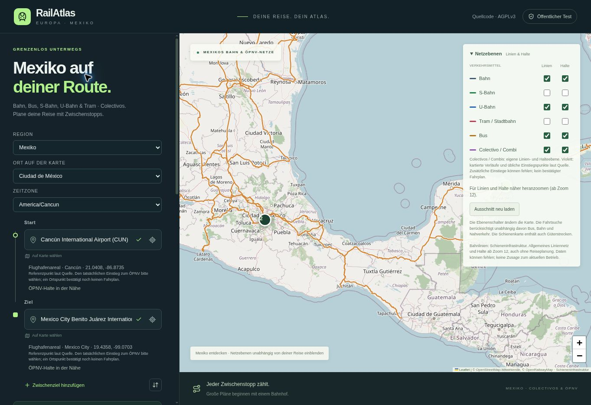
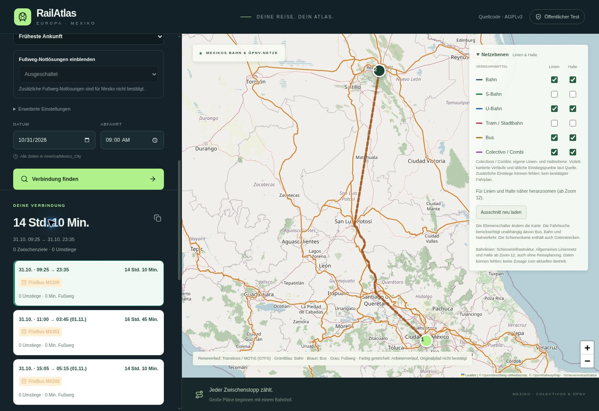

# RailAtlas 33: Flughäfen und nachvollziehbare Mexiko-Reiseplanung

Veröffentlicht am 29.10.2026. Sites-Quellcommit
`aa37a613c1af2e97d141cab1271188afe6c82a28`; 1.023 App-Dateien werden bytegleich
nach GitHub gespiegelt.

## Befunde und Änderungen

| Befund | Änderung | Nachweis |
| --- | --- | --- |
| CUN/MEX und Flughafen-/Terminalnamen fehlen, weil die Ortssuche nur Busstopps und Busbahnhöfe abfragt. | Gemeinsame Suche ergänzt Flughafenareale, Terminals und echte OSM-Orte. 63 mexikanische Flughäfen aus OurAirports; keine fingierten Haltestellen. | Öffentliche CUN- und MEX-Abfragen liefern je einen eindeutig gekennzeichneten Flughafen. Terminal 2 CUN/MEX liefern zusätzlich reale Terminal-/Halteobjekte. |
| Mexiko-Stadt–Monterrey liefert drei Busfahrten; alle werden wegen eines anderen Zielhalts verworfen. | Abweichende tatsächliche Halte werden mit Entfernung zur ausdrücklichen Übernahme angeboten. Strenge Endpunkt- und Fußwegprüfung bleibt. | Anderer nativer Zielhalt 63 m entfernt; ursprüngliche Auswahl HTTP 422, nach Auswahl des tatsächlichen Halts HTTP 200 mit drei Reisen. |
| Leere Antworten und verworfene Vorschläge erscheinen gleich; Fehlertexte nennen weiterhin Europa. | Strukturierte Diagnose, neutrale Transitous-Texte. HTTP 422 für fachlich negative Reiseantworten; echte Anbieterausfälle bleiben Fehler. | Endpunkt-Abweichung: 3 Vorschläge / 0 übernommen; Cancún-Flughafenprobe: 0 Vorschläge. Getrennte Regressionen. |
| Gleichnamige Halte aus weit entfernten Städten und sogar Texas erscheinen unklar. | Räumliches Suchgebiet und Ortskontext; bekannte Stadtanfragen berücksichtigen ihren eigenen Mittelpunkt. Koordinaten bleiben in der Auswahl sichtbar. | Handley & Monterrey in Fort Worth fällt aus der Mexiko-Suche; Monterrey und gleichnamige CDMX-Halte werden getrennt gekennzeichnet. |
| Kartenebenen können als Fahrtsuchfilter missverstanden werden. | Sichtbarer Hinweis: Schalter steuern die Karte, die Fahrtsuche ist unabhängig. Schieneninfrastruktur enthält auch Güterstrecken. | Gemeinsame Kartenkomponente für beide Veröffentlichungen. |

## Flughafen-Orte und Halte

OurAirports liefert Referenzkoordinaten und IATA-/ICAO-Codes; diese Punkte sind
keine bestätigten Eingänge, Bahnsteige oder Busbuchten. Quelle:
https://ourairports.com/data/ (Public Domain), Abruf 29.10.2026. Originalprüfsumme
und räumliche Suchfilterquelle stehen in der Anwendung unter
`public/data/mexico-places-sources.json`. Der Geofabrik-Umriss ist ein OSM-
Extraktgebiet, keine rechtsverbindliche Staatsgrenze. Für native Anbieterhalte
wird weiterhin kein Land aus Feed-Präfixen geraten.

„ÖPNV-Halte in der Nähe“ listet echte Quellhalte; die vorher gewählte Flughafen-
position bleibt erhalten, bis der Nutzer einen Halt übernimmt. Der Zugang ist
vor Ort zu prüfen. Flughafenstart nahe einer bekannten Ortsauswahl übernimmt
deren Zeitzone unter Erhalt des UTC-Zeitpunkts; die Zeitzone bleibt sichtbar
und wählbar. Native Zeitangaben werden bei vorhandenem Anbieterfeld erhalten.

## Tatsächliche Reiseproben und Grenzen

Die öffentliche API bestätigt für 31.10.2026 ab 09:00 America/Mexico_City:
Mexico City Buenavista (Fórum Buenavista) → Monterrey Centro
(B. Reyes 1214 - Titanes), drei Busreisen. Erste Reise: FlixBus MX200,
09:25–23:35 Ortszeit, ohne erfundenen Weg zum ursprünglich gewählten,
63 m entfernten Haltepunkt. Die echte vollständige Quellantwort liegt als
Parserfixture vor. Zwei verschiedene Kennungen werden weiterhin nicht
zusammengelegt; Abweichungen über 800 m, Ausfälle und Zeitkonflikte erzeugen
keinen solchen Vorschlag.

Flughafen CUN → ADO Terminal de Autobuses Cancún liefert in der angebundenen
Auskunft **keine Reise**. Die Fehlerantwort nennt 0 Quellvorschläge und bewahrt
keinen vorgetäuschten Reiseerfolg. Die Existenz von ADO-Flughafenbussen ist
separat auf der offiziellen ADO-Seite beschrieben:
https://contenido.ado.com.mx/marca-ado-aeropuerto . Diese Seite wird als
Anbieterauskunft verlinkt; ADO-Fahrpläne werden dadurch nicht intern berechnet.

Auch die zusätzliche Probe Terminal Aérea → Buenavista liefert für das gewählte
Datum in Transitous keine Reise. Diese Abdeckungslücken bleiben offen. Es wird
kein Busfahrplan aus OSM-Geometrie, allgemeinen Frequenzangaben oder einer
Anbieter-Werbeseite erzeugt. Das konkrete ursprüngliche Screenshot-Request mit
Haltekennungen liegt nicht vor; die reproduzierten Fälle sind ausdrücklich die
hier genannten Proben.

## Prüfung

140 Regressionen, TypeScript sowie Worker-, Standalone- und Pages-Build
 erfolgreich. Die Regressionen enthalten die bisherigen Europa-Fälle und echte
Mexiko-/Monterrey-Antworten. Erneute Stationssuche in 43 Orten: 43 HTTP 200,
keine Strukturfehler und keine leeren Antworten. Dies prüft Suche und Datenformat,
nicht 43 erfolgreiche Reiseplanungen. Öffentliche API-Proben einschließlich
GitHub-CORS stehen in `mexico-routing-2026-10-29.json`.

Im öffentlichen Browser wurden CUN als Start, MEX als Ziel und MTY als
Zwischenziel gewählt. Cancún übernimmt America/Cancun. Die Nahbereichsauswahl
liefert unter anderem ADO taquilla, ADO bus stop und ADO Bus Station aus den
Kartendaten; keine automatische Gleichsetzung mit dem Flughafenpunkt.

Im Browser wurde der ursprüngliche Monterrey-Suchtreffer angefragt. Die Antwort
zeigte den tatsächlichen Ankunftshalt mit 63 m Abstand und „Als Ziel übernehmen“.
Nach ausdrücklicher Übernahme und erneuter Suche zeigt die öffentliche Version
drei Alternativen: MX200 09:25–23:35, MX351 11:00–03:45 am Folgetag, MX200
15:05–05:15 am Folgetag. Die Angabe zum nur teilweise bestätigten Störungsstand
und zur unbestätigten Herkunft der Anbietergeometrie bleibt sichtbar.

